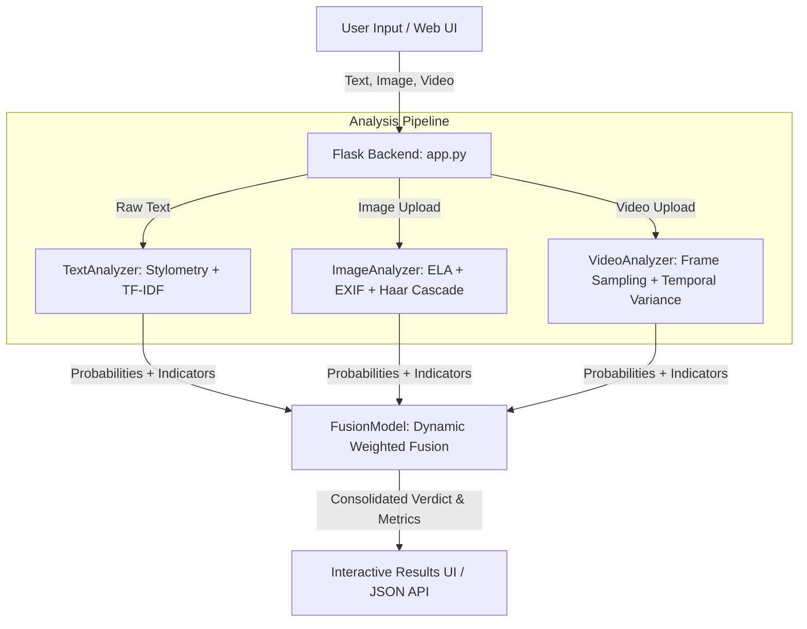

# VerifAI — Multimodal Fake News & Misinformation Detection System

[](https://www.python.org/)
[](https://flask.palletsprojects.com/)
[](https://www.docker.com/)
[](LICENSE)

**VerifAI** is an advanced, multimodal misinformation and fake news verification platform. It combines textual stylometry and NLP, computer vision forensics (Error Level Analysis), frame-level temporal video diagnostics, and an adaptive confidence-weighted fusion model to deliver nuanced, explainable verdicts across multiple media types.

---

## 📑 Table of Contents

- [Overview](#-overview)
- [Key Features](#-key-features)
- [System Architecture](#-system-architecture)
- [Core Analysis Modules](#-core-analysis-modules)
  - [1. Text Analyzer](#1-text-analyzer)
  - [2. Image Forensics Analyzer](#2-image-forensics-analyzer)
  - [3. Video Frame Analyzer](#3-video-frame-analyzer)
  - [4. Multimodal Fusion Engine](#4-multimodal-fusion-engine)
- [Project Structure](#-project-structure)
- [Getting Started](#-getting-started)
  - [Prerequisites](#prerequisites)
  - [Local Installation](#local-installation)
  - [Running the Application](#running-the-application)
- [Model Evaluation & Training](#-model-evaluation--training)
- [API Reference](#-api-reference)
- [Deployment Options](#-deployment-options)
  - [Docker](#docker)
  - [Hugging Face Spaces](#hugging-face-spaces)
  - [Render / Railway / Heroku](#render--railway--heroku)
- [UI & Aesthetics](#-ui--aesthetics)
- [Contributing & License](#-license)

---

## 🌟 Overview

Misinformation rarely travels in text alone; modern disinformation campaigns deploy spliced screenshots, doctored video clips, and clickbait copy together. VerifAI inspects all three vectors simultaneously or independently, providing users and fact-checkers with:

1. **A Single Unified Verdict**: `REAL`, `FAKE`, or `UNCERTAIN` with overall confidence and fake-probability scores.
2. **Explainable Breakdowns**: Actionable insights per modality, such as detected manipulation indicators, sensationalist markers, and compression anomalies.
3. **Privacy-Preserving & Lightweight**: Fast inference without requiring heavy GPU clusters, making it instantly deployable anywhere.

---

## ⚡ Key Features

- **Multimodal Ingestion**: Inspect text paragraphs, uploaded images (`.jpg`, `.png`, `.webp`, `.bmp`), and video files (`.mp4`, `.avi`, `.mov`, `.webm`, `.mkv`).
- **Humanized Editorial Interface**: Crafted with a bespoke black & white editorial aesthetic (Playfair Display & Inter typography, clean micro-interactions, dark footer, and zero clutter).
- **Error Level Analysis (ELA)**: Detects digital splices and resaved JPEG regions by calculating digital error variance across compression levels.
- **Haar Cascade Facial Verification**: Verifies facial presence and structural features within images and video frames.
- **Temporal Consistency Checking**: Evaluates frame-to-frame variance in videos to flag deepfakes, spliced edits, and anomalous segments.
- **Explainable Metrics**: Returns detailed signal flags (e.g., *sensational headline patterns*, *excessive punctuation*, *ELA variance anomalies*, *metadata omissions*).
- **One-Click Local Launchers**: Windows `.bat` launch scripts for both the Flask web server and Jupyter notebook environments.

---

## 🏗 System Architecture



---

## 🔬 Core Analysis Modules

### 1. Text Analyzer
- **Stylometric & Linguistic Checks**: Evaluates lexical diversity, uppercase letter ratios, punctuation densities, and readability.
- **Sensationalism & Clickbait Detection**: Identifies emotionally charged, unsubstantiated buzzwords and clickbait patterns.
- **Machine Learning Classifier**: Utilizes TF-IDF n-gram vectorization (unigrams & bigrams) coupled with a balanced Logistic Regression classifier trained on curated news verification datasets.

### 2. Image Forensics Analyzer
- **Error Level Analysis (ELA)**: Re-compresses the image at a standard quality level (90–95%) and inspects pixel-level differential matrices. Areas that were modified or pasted in show distinctive error signatures compared to natural photo noise.
- **Facial Consistency**: Uses OpenCV Haar Cascade Classifiers to detect faces and ensure facial visual integrity.
- **EXIF Metadata Inspection**: Flags altered timestamps, missing camera make/model data, and manipulation software fingerprints (e.g., Photoshop, GIMP).

### 3. Video Frame Analyzer
- **Uniform Frame Sampling**: Extracts up to 12 representative frames distributed evenly across the video runtime.
- **Frame-Level Forensics**: Passes each sampled frame through the image forensics pipeline.
- **Temporal Variance & Anomaly Detection**: Computes inter-frame standard deviation. Spikes exceeding 1.5× standard deviation highlight spliced frames or visual discontinuities.

### 4. Multimodal Fusion Engine
- **Base Modality Weights**:
  - Text: **40%**
  - Image: **35%**
  - Video: **25%**
- **Adaptive Confidence Scaling**: Modalities with higher self-reported certainty are weighted more heavily, while modalities returning `UNCERTAIN` or errors receive dynamic weight discounting.

---

## 📁 Project Structure

```plaintext
sample/
├── app.py                      # Flask application entry point & API routes
├── Dockerfile                  # Production container configuration
├── Procfile                    # Heroku / PaaS process declaration
├── railway.toml                # Railway deployment config
├── render.yaml                 # Render web service specification
├── runtime.txt                 # Target Python runtime version
├── requirements.txt            # Python dependencies
├── evaluate_text.py            # Model training & offline evaluation script
├── VerifAI_Notebook.ipynb      # Interactive Jupyter exploration notebook
├── Launch_WebApp.bat           # 1-Click launcher for Flask web server
├── Launch_Jupyter.bat          # 1-Click launcher for Jupyter Notebook
├── test_news.csv               # Dataset for training & evaluation
├── confusion_matrix.png        # Evaluation confusion matrix plot
├── evaluation_predictions.csv  # Test set validation predictions
├── models/
│   ├── __init__.py             # Package initializer
│   ├── text_analyzer.py        # Text & NLP analysis module
│   ├── image_analyzer.py       # Image forensics (ELA, EXIF, Haar Cascade)
│   ├── video_analyzer.py       # Video frame sampling & temporal consistency
│   └── fusion.py               # Multimodal confidence-weighted fusion model
├── static/
│   ├── css/
│   │   └── style.css           # Custom Humanized B&W stylesheet
│   ├── js/
│   │   └── main.js             # Client-side validation, async upload & UI rendering
│   └── uploads/                # Temporary directory for media processing
└── templates/
    └── index.html              # Single-page web application interface
```

---

## 🚀 Getting Started

### Prerequisites
- **Python 3.10+**
- **pip** package manager
- *(Optional)* **Docker** if deploying with containers

### Local Installation

1. **Clone the repository**:
   ```bash
   git clone https://github.com/Santosh9944/sample.git
   cd sample
   ```

2. **Create and activate a virtual environment**:
   ```bash
   # Windows
   python -m venv venv
   venv\Scripts\activate

   # Linux / macOS
   python3 -m venv venv
   source venv/bin/activate
   ```

3. **Install the dependencies**:
   ```bash
   pip install -r requirements.txt
   ```

### Running the Application

- **Via Python direct**:
  ```bash
  python app.py
  ```
- **Via Windows Quick Launcher**:
  Double click [`Launch_WebApp.bat`](file:///c:/Users/santo/OneDrive/Desktop/Exampleee/New%20folder/sample/Launch_WebApp.bat).

Once started, open your browser and navigate to:
```
http://localhost:5000
```

---

## 📊 Model Evaluation & Training

The repository includes a dedicated model evaluation pipeline ([`evaluate_text.py`](file:///c:/Users/santo/OneDrive/Desktop/Exampleee/New%20folder/sample/evaluate_text.py)):

```bash
python evaluate_text.py
```

### Evaluation Output
- Trains an n-gram TF-IDF vectorizer + balanced logistic classifier on [`test_news.csv`](file:///c:/Users/santo/OneDrive/Desktop/Exampleee/New%20folder/sample/test_news.csv).
- Computes **Accuracy**, **Precision**, **Recall**, and **F1-Score**.
- Generates a Seaborn heatmap [`confusion_matrix.png`](file:///c:/Users/santo/OneDrive/Desktop/Exampleee/New%20folder/sample/confusion_matrix.png) and test predictions file [`evaluation_predictions.csv`](file:///c:/Users/santo/OneDrive/Desktop/Exampleee/New%20folder/sample/evaluation_predictions.csv).

---

## 🔌 API Reference

### `POST /analyze`
Accepts `multipart/form-data` with one or more input fields:

| Field | Type | Description |
|---|---|---|
| `text` | string *(optional)* | News article text, headline, or excerpt |
| `image` | file *(optional)* | Image file (`png`, `jpg`, `jpeg`, `webp`, `bmp`) |
| `video` | file *(optional)* | Video file (`mp4`, `avi`, `mov`, `webm`, `mkv`) |

#### Sample Response (`200 OK`):
```json
{
  "verdict": "REAL",
  "fake_probability": 0.18,
  "real_probability": 0.82,
  "confidence": 0.82,
  "modalities_used": ["text", "image"],
  "modalities": {
    "text": {
      "verdict": "REAL",
      "fake_probability": 0.15,
      "real_probability": 0.85,
      "confidence": 0.85,
      "effective_weight": 0.34
    },
    "image": {
      "verdict": "REAL",
      "fake_probability": 0.22,
      "real_probability": 0.78,
      "confidence": 0.78,
      "effective_weight": 0.27
    }
  }
}
```

### `GET /health`
Returns service status:
```json
{
  "status": "ok",
  "service": "VerifAI"
}
```

---

## 🚢 Deployment Options

### Docker
Build and run using the included [`Dockerfile`](file:///c:/Users/santo/OneDrive/Desktop/Exampleee/New%20folder/sample/Dockerfile):
```bash
docker build -t verifai .
docker run -p 5000:5000 verifai
```

### Hugging Face Spaces
The repository contains Hugging Face YAML metadata configured for Docker SDK on port `7860`. Push to your Hugging Face Space repository directly to launch.

### Render / Railway / Heroku
- **Render**: Automatically recognized using [`render.yaml`](file:///c:/Users/santo/OneDrive/Desktop/Exampleee/New%20folder/sample/render.yaml).
- **Railway**: Configured with [`railway.toml`](file:///c:/Users/santo/OneDrive/Desktop/Exampleee/New%20folder/sample/railway.toml).
- **Heroku / PaaS**: Compatible via [`Procfile`](file:///c:/Users/santo/OneDrive/Desktop/Exampleee/New%20folder/sample/Procfile) (`web: gunicorn app:app`).

---

## 🎨 UI & Aesthetics

VerifAI features a humanized editorial visual identity:
- **Typography**: Playfair Display (editorial serif headers) paired with Inter (functional modern body) and JetBrains Mono (numerical indicators).
- **Palette**: Warm newspaper cream (`#f8f7f4`), high-contrast ink black (`#111111`), subtle borders, and zero gaudy neon gradients.
- **Responsive Layout**: Designed for seamless fact-checking workflows across desktop and mobile screens.

---

## 📄 License

This project is licensed under the MIT License — see the repository files for details.
